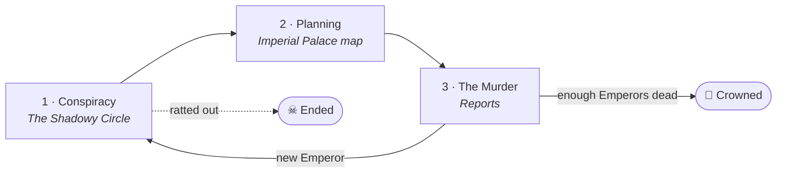

# Execute the Emperor

> Recruit a conspiracy. Plan the perfect murder. Find out what really
> happened. Do it again — until the crown is yours.

**Status:** 🌱 idea stage. Nothing is being built yet — this repo is the one
place every idea for the game lives.

---

## The game in one screen

You're building a conspiracy to kill the Emperor. Each Emperor takes three
phases, each with its own screen:

| # | Phase | Screen | What you do |
|---|---|---|---|
| 1 | [**Conspiracy**](docs/design/01-conspiracy.md) | The Shadowy Circle *(forum)* | Hire, charm or blackmail co-conspirators. Execute them or leave them alive — but anyone left alive might rat you out. |
| 2 | [**Planning**](docs/design/02-planning.md) | The Imperial Palace *(map)* | Choose how the Emperor dies; fund it; get closer; lock doors, swap guards. Parts of the palace are obscured. |
| 3 | [**The Murder**](docs/design/03-the-murder.md) | Reports | Be there and see everything (but raise suspicion), or stay away and rely on reports — and how you read them decides which plots grow. |

Then a new Emperor takes the throne and it starts again.
**Kill enough Emperors and you're [crowned yourself](docs/design/04-the-crown.md).**

There's also a [**board game** take](docs/design/05-board-game.md):
pressure tokens build up, and once they hit a value you have to plot.

## What's in here

| Path | What it is |
|---|---|
| [`docs/design/`](docs/design/) | One doc per phase, plus the restart loop and the board game. Each starts with your notes word for word, then a tidied-up version. |
| [`docs/open-questions.md`](docs/open-questions.md) | Everything the notes leave open — the agenda for the next brainstorm. |
| [`docs/glossary.md`](docs/glossary.md) | Working vocabulary (grasp, suspicion, pressure tokens, …). |
| [`ideas/raw/`](ideas/raw/) | Original notes, verbatim. Never edited. |
| [`ideas/inbox.md`](ideas/inbox.md) | Drop new ideas here. |
| [`sources/`](sources/) | Where ideas have been found (and searched for) across Drive, OneDrive, Gmail, etc., plus inspirations. |

## Adding ideas

1. Jot it in [`ideas/inbox.md`](ideas/inbox.md) with a date — any spelling,
   any format.
2. Longer brain-dumps (a pasted OneNote page, a voice-note transcript) go in
   `ideas/raw/` as a new dated file.
3. When sorting, fold ideas into the matching design doc and tick off
   anything they answer in `docs/open-questions.md`.
