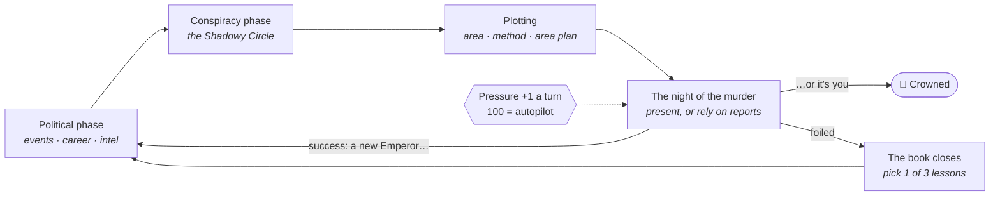

# Execute the Emperor

> A deckbuilder about killing the Emperor of Rome — and getting away with it.
> Recruit co-conspirators, learn his weaknesses, set the scene like a
> chessboard, and beat the clock before the plot slips out of your hands.

**Status:** 🌱 idea stage, with a first paper prototype to play. Nothing
digital is being built yet — this repo is the one place every idea for the
game lives.

**Format:** board game first ([decisions](docs/decisions.md)) — a
deckbuilder where the deck is built by drafting co-conspirators, driven by
a market-deckbuilder turn (D4, D5).
**Next:** play the [paper prototype](docs/prototype/rules.md) — the card
layer of [Sprint 1](docs/sprint-1.md), solo, about 11 turns, with a
stand-in ending. The murder stage is parked for now.

---

## The game in one screen

You're an ambitious Roman plotting to assassinate the Emperor. It's a
**resource-management deckbuilder with roguelite runs**, not an action game.
*(Overview: [docs/overview.md](docs/overview.md))*

*One possible shape. The notes also describe three phases, never fix the
order, leave the Plotting page empty, and don't settle what follows a
successful kill — see [audit CA-01](docs/audit/contradictions.md#ca-01--three-phases-in-basics-vs-four-phase-pages)
and [CA-44](docs/audit/contradictions.md#ca-44--one-assassination-then-restart-vs-many-emperors-in-one-run-vs-stick-to-one-and-how-you-get-crowned).*

| System | In one line |
|---|---|
| [**Pressure**](docs/design/02-pressure.md) | A 0–100 clock that's easy to raise, almost impossible to lower — better recruits as it climbs, blackmail and chaos as it peaks. |
| [**Co-conspirators**](docs/design/04-co-conspirators.md) | Drafted as cards; they bring stats, cards (even curses), and access — and they're sticky. |
| [**Stats and checks**](docs/design/03-stats-and-checks.md) | Everything 0–100; d100 roll-under checks; traits bend how stats affect each person. |
| [**The Emperor**](docs/design/06-the-emperor.md) | The target. Intel cards like *Creature of Habit* or *Partially Blind* decide which plans are possible. |
| [**The assassination**](docs/design/07-the-assassination.md) | Pick area, method and conspirators; lock doors, plant spies, bribe guards; be there or rely on reports. |
| [**Politics**](docs/design/08-politics-and-reputation.md) | Build your career, earn honorifics, run propaganda — rivals are climbing too. |
| [**Between runs**](docs/design/09-between-runs.md) | A failed plot was a story read to a young man; he picks a lesson → permanent upgrade. |

It's being designed [**board game first**](docs/design/10-board-game.md)
([D2](docs/decisions.md)) — in that version, pressure tokens build up, and
once they hit a value you have to plot.

## What's in here

| Path | What it is |
|---|---|
| [`docs/overview.md`](docs/overview.md) | The pitch, genre, setting, touchstones and design principles. |
| [`docs/design/`](docs/design/) | One doc per system, written up from the notes, with gaps marked. |
| [`docs/decisions.md`](docs/decisions.md) | Decisions made so far. |
| [`docs/sprint-1.md`](docs/sprint-1.md) | Draft plan for the first sprint: the card layer, on paper. |
| [`docs/prototype/`](docs/prototype/) | The paper prototype: [rules](docs/prototype/rules.md), [cards](docs/prototype/cards.md) and a [playtest log](docs/prototype/playtest-log.md). |
| [`docs/design-review.md`](docs/design-review.md) | Claude's take: what's strong, what's risky. |
| [`docs/audit.md`](docs/audit.md) | Where the notes contradict each other, what's missing, empty pages — full lists in [`docs/audit/`](docs/audit/). |
| [`docs/open-questions.md`](docs/open-questions.md) | Decisions still to make — the agenda for the next session. |
| [`docs/glossary.md`](docs/glossary.md) | Working vocabulary. |
| [`docs/resources.md`](docs/resources.md) | Godot courses and links. |
| [`docs/name-and-prior-art.md`](docs/name-and-prior-art.md) | Is the name taken? Which games are closest? |
| [`ideas/raw/`](ideas/raw/) | Original notes, verbatim — the OneNote notebook (PDF + transcript) and chat notes. Never edited. |
| [`ideas/inbox.md`](ideas/inbox.md) | Drop new ideas here. |
| [`sources/`](sources/) | Where ideas have been found, and what's still to import. |

## Adding ideas

1. Jot it in [`ideas/inbox.md`](ideas/inbox.md) with a date — any spelling,
   any format.
2. Longer brain-dumps (a pasted OneNote page, a voice-note transcript) go in
   `ideas/raw/` as a new dated file.
3. When sorting, fold ideas into the matching design doc and tick off
   anything they answer in [`docs/open-questions.md`](docs/open-questions.md).
